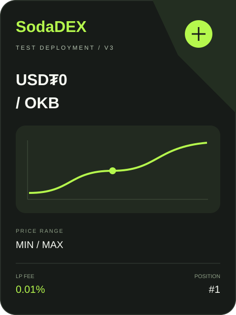
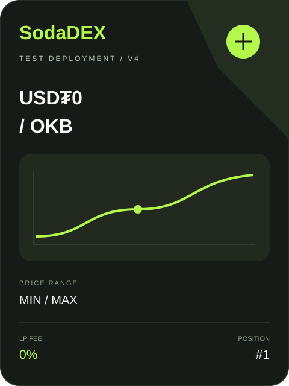

# SodaDEX V3 / V4 当前测试合约地址

网络：**X Layer 主网 196**。RPC：`https://rpc.ignix.bot/rpc/196`。以下均为已完成回执和代码核验的实际测试部署，生产部署留待后续。

**公开测试站已开放自有测试池兑换、仓位操作和限价单；每次用户操作均需钱包确认，官方池保持只读。**

Owner：`0x6ecf746b078d46391f8C425B150153212F7C0545`。本轮品牌更新、建池和兑换总 gas **0.000619773462 OKB**（包含此前三笔），上限 0.0007 OKB；总本金按累计发送额计算不超过 0.0002 OKB。

| 合约 | 当前地址 | 来源 | 部署交易 |
| --- | --- | --- | --- |
| V3 Factory | [0xa6109b7f4237d2ac28b8009fbd21b88cff194cfe](https://www.oklink.com/xlayer/address/0xa6109b7f4237d2ac28b8009fbd21b88cff194cfe) | 复用基础部署 | [0x1c5d2b5a0831077e56133eb5308a86ff0eda38108792b3214e9190c034d18953](https://www.oklink.com/xlayer/tx/0x1c5d2b5a0831077e56133eb5308a86ff0eda38108792b3214e9190c034d18953) |
| V3 NFTDescriptor 库 | [0x5abe8f32072b46e67816db5991033e06d3b000d1](https://www.oklink.com/xlayer/address/0x5abe8f32072b46e67816db5991033e06d3b000d1) | 本轮品牌更新 | [0x3c442bc4fb66289a77e5f809b8253883aa29548ec08fde4429860bb59ab67691](https://www.oklink.com/xlayer/tx/0x3c442bc4fb66289a77e5f809b8253883aa29548ec08fde4429860bb59ab67691) |
| V3 TokenDescriptor | [0xe8738389c2027bfcd4ac0dde764df9f170eb9750](https://www.oklink.com/xlayer/address/0xe8738389c2027bfcd4ac0dde764df9f170eb9750) | 本轮品牌更新 | [0x7b1d39d9d638904798b625b4b321f7ad71ab89ad3691832073101ddd0e7f37a0](https://www.oklink.com/xlayer/tx/0x7b1d39d9d638904798b625b4b321f7ad71ab89ad3691832073101ddd0e7f37a0) |
| SodaDEX V3 PositionManager | [0x2becd78e05fb33b0588e9cf61e65afee9dc7428f](https://www.oklink.com/xlayer/address/0x2becd78e05fb33b0588e9cf61e65afee9dc7428f) | 本轮品牌更新 | [0x9a4fa6bdffb12fa6e5d50fd51afdbb80902322270fa83efff171f1730328b460](https://www.oklink.com/xlayer/tx/0x9a4fa6bdffb12fa6e5d50fd51afdbb80902322270fa83efff171f1730328b460) |
| V3 QuoterV2 | [0x98f4dfbfab6fc37e59e00d6881e779b33b23b009](https://www.oklink.com/xlayer/address/0x98f4dfbfab6fc37e59e00d6881e779b33b23b009) | 复用基础部署 | [0x007ad495f25e2123f2818b0b3a9037af4b66a9f2742099011ac9bbc190141e7e](https://www.oklink.com/xlayer/tx/0x007ad495f25e2123f2818b0b3a9037af4b66a9f2742099011ac9bbc190141e7e) |
| V4 PoolManager | [0x6b5c32ad97eb42230138e02a21b0e6d811fd713d](https://www.oklink.com/xlayer/address/0x6b5c32ad97eb42230138e02a21b0e6d811fd713d) | 复用基础部署 | [0x6920add66040fd7af83d2fe8845b2942c4de6f3a1a354d00b70251c6f1e0d0d2](https://www.oklink.com/xlayer/tx/0x6920add66040fd7af83d2fe8845b2942c4de6f3a1a354d00b70251c6f1e0d0d2) |
| V4 Descriptor | [0x1d59446d84e2470015dc926d9df7d83a2395d264](https://www.oklink.com/xlayer/address/0x1d59446d84e2470015dc926d9df7d83a2395d264) | 本轮品牌更新 | [0x1f585e94e07982fcd872c381c69c9a7f6fb37d9f8a9d56c4772001bb61b3c9a7](https://www.oklink.com/xlayer/tx/0x1f585e94e07982fcd872c381c69c9a7f6fb37d9f8a9d56c4772001bb61b3c9a7) |
| SodaDEX V4 PositionManager | [0x1f85377930011b701dd2940c526e32fd3adab730](https://www.oklink.com/xlayer/address/0x1f85377930011b701dd2940c526e32fd3adab730) | 本轮品牌更新 | [0x316ed1e3b31d1aa61f7e72f8ff0f62859e32f26a1c98621cdcdf946abf027b9a](https://www.oklink.com/xlayer/tx/0x316ed1e3b31d1aa61f7e72f8ff0f62859e32f26a1c98621cdcdf946abf027b9a) |
| V4 Quoter | [0x7a188d4c46c9fe045a5875fecaef9bf00e4521ff](https://www.oklink.com/xlayer/address/0x7a188d4c46c9fe045a5875fecaef9bf00e4521ff) | 复用基础部署 | [0x787a652148d1102eed7ec3c3a14727ff7a23ad7f5a3d6effb377a7c2b77045b3](https://www.oklink.com/xlayer/tx/0x787a652148d1102eed7ec3c3a14727ff7a23ad7f5a3d6effb377a7c2b77045b3) |
| V4 StateView | [0x7991d4a8493b9709365cd079dffc75e790007874](https://www.oklink.com/xlayer/address/0x7991d4a8493b9709365cd079dffc75e790007874) | 复用基础部署 | [0x4b341a1f30d8e254aea8165872e3cb95f2ff9a8a93a7b341bc0abc1d0a2d8152](https://www.oklink.com/xlayer/tx/0x4b341a1f30d8e254aea8165872e3cb95f2ff9a8a93a7b341bc0abc1d0a2d8152) |
| UnsupportedProtocol | [0x68eca93437df07be4b2c3a67956ace2dc87d2f39](https://www.oklink.com/xlayer/address/0x68eca93437df07be4b2c3a67956ace2dc87d2f39) | 复用基础部署 | [0x6b82ed35bf18729ec89ac692df89c2e63979e179f0c2c758d85c1b210fa45d44](https://www.oklink.com/xlayer/tx/0x6b82ed35bf18729ec89ac692df89c2e63979e179f0c2c758d85c1b210fa45d44) |
| SodaDEX Universal Router | [0xda5bc8bc981d9b2f5df2b0c7e5aed044993709fa](https://www.oklink.com/xlayer/address/0xda5bc8bc981d9b2f5df2b0c7e5aed044993709fa) | 本轮品牌更新 | [0x1abab95972697fc4ac3655a675d460f7abdfdbd0da4a287db8f3d787804023dc](https://www.oklink.com/xlayer/tx/0x1abab95972697fc4ac3655a675d460f7abdfdbd0da4a287db8f3d787804023dc) |

## 已创建的测试池

V3：**WOKB / USD₮0，0.01%**，全范围。池地址：[0x5c6825eff223ba53744c2a19a0aec27033a432bd](https://www.oklink.com/xlayer/address/0x5c6825eff223ba53744c2a19a0aec27033a432bd)。仓位 NFT：`SODA-V3-POS #1`，Owner 同上。

V4：**原生 OKB / USD₮0，0%**，tickSpacing=1、hooks=0，全范围。PoolManager 为上表当前地址；池标识（不是独立合约地址）：

`0x326670fbdc54a57ec96182faebc60ce6f06e9073e0044e978805520be3c6983e`

仓位 NFT：`SODA-V4-POS #1`，Owner 同上。两个池均已完成原生 OKB 输入 0.000001、反向 USD₮0 输入 0.0001 的微额兑换，逐笔核对事件、实际余额、最低输出和无残留。

## SodaDEX 仓位图片

以下图片来自真实链上 NFT 的 tokenURI，包含测试部署标记：

当前配置：[active.json](active.json)；池配置：[pools.json](pools.json)；本轮完整回执及核验：[branding-receipts.json](branding-receipts.json)；构建指纹：[branding-build.json](branding-build.json)。

原始基础部署的 plan.json / receipts.json 保留为历史记录。原 NFT 管理器和路由已由本表地址取代；原 V3 管理器授权已清零。区块浏览器源码验证尚未提交。

## 测试限价单结算

SodaLimitSettlement：[0xE713AfD6133207df18662080e2B0F7e456AeEBA5](https://www.oklink.com/xlayer/address/0xE713AfD6133207df18662080e2B0F7e456AeEBA5)，部署区块 `73438869`，[部署交易](https://www.oklink.com/xlayer/tx/0x2144f86f7ce985ce9f1ac6b0e5aff56bb799645dd99c256e0f8ba58dd9d2f459)。专用 gas keeper：`0x7c8998946896d1dFF8F70f00ba1392938Fb5b3a2`。平台费为 0，生产合约未变更。

本阶段独立总 gas 上限为 **0.0002 OKB**（owner 操作与 keeper 累计各最多 0.0001）。专用 keeper 初始资金为 0.0001 OKB，不将转账本金重复记为已消耗 gas。完整台账、微量成交与撤单证明见 [orders-receipts.json](orders-receipts.json)。
